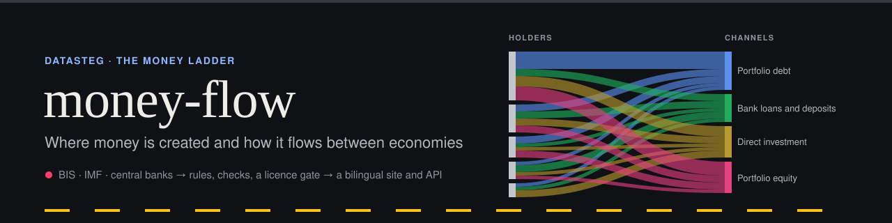

# Sinho, as money-flow uses it

**Sinho** (version 1) is the design system money-flow is drawn in. Its idea is a city's street signage: concrete
pavement by day, wet asphalt by night, the blue of a Korean road and station sign, road centre-line yellow and the
red-pink of an LED shop sign. *Signage, not decoration:* hard corners, solid fills, hairlines, one action colour, and
one warm light per screen.

| File | What it is |
|---|---|
| [`design/tokens.json`](design/tokens.json) | Every token with its Day and Night value and its usage note (colour, type, spacing, radius, shadow, layout, breakpoints, z-index, opacity, canvas) |
| [`design/build-tokens.mjs`](design/build-tokens.mjs) | Writes `design/tokens.css` (Day on `:root`, Night under `[data-theme="dark"]` and, before a reader has chosen, under `prefers-color-scheme: dark`) and `design/sinho.css` (the component styles without remote imports). Both are generated, so they are not checked in; `pnpm tokens` in `app/` runs it |
| [`design/bundle.css`](design/bundle.css), [`design/bundle.js`](design/bundle.js), [`design/index.d.ts`](design/index.d.ts) | The reference components and their types |
| [`app/components/sn/`](app/components/sn) | The React versions money-flow uses (Masthead, LanguageSwitch, ThemeToggle, SegmentedControl, StatTile, Delta, Sparkline, Notice, Tag, PaperCard, ChartCard, DataTable, Ticker, icons) |
| [`app/app/site.css`](app/app/site.css) | money-flow's own layout on Sinho: only `var(--token)` colours, no hex values |
| [style page](https://money-flow.datasteg.com/en/style) | Every token drawn from the live CSS in both themes, so the system can be checked by eye |

## Palette

### Identity

| Token | Hex | Role |
|---|---|---|
| `--concrete` | `#F2F2EF` | Pavement by day: the page surface in the Day theme |
| `--slab` | `#E6E6E2` | A concrete slab: quiet panels by day, and money-flow's Day ground |
| `--asphalt` | `#101114` | Wet asphalt: ink by day, the page by night. Never pure black |
| `--sign` | `#0A55D6` | The Sinho colour, a Korean road-sign blue: the action fill by day, always with white text |
| `--sign-lit` | `#6FA3FF` | The same sign backlit at night: the action fill by night, with asphalt text |
| `--centerline` | `#FFC31A` | Road centre-line yellow: marks on dark ground, the signboard's buttons and plates |
| `--led` | `#FF3D6E` | An LED shop sign: one dot beside the newest day, never a large fill |

### Roles (Day / Night)

| Token | Day | Night | Where money-flow uses it |
|---|---|---|---|
| `--surface` | `#F2F2EF` | `#101114` | The page background of the Sinho components |
| `--surface-concrete` | `#E8E8E4` | `#1A1C20` | Quiet panels; money-flow's cards by night |
| `--surface-tint` | `#E3ECFB` | `#15233B` | Sign-blue callouts and the selected row |
| `--line` | `#D3D3CE` | `#2B2E34` | Hairlines: card borders, dividers, gridlines |
| `--line-strong` | `#83857F` | `#6A6E75` | Borders that carry meaning; dashed lane dividers around the rung panels and above the source line |
| `--ink` | `#101114` | `#EDEDEA` | Primary text (≥ 15:1) |
| `--ink-secondary` | `#44474C` | `#B3B6BB` | Labels, deks, chart values (≥ 7:1) |
| `--ink-muted` | `#5C5F64` | `#90949A` | Metadata only: times, captions, axis ticks |
| `--accent` | `#0A55D6` | `#6FA3FF` | The one action fill: primary button, switch on, selected segment |
| `--link` | `#0A4FC4` | `#8DB6FF` | Links, kickers, the active tab text, the language switch |
| `--focus` | `#0A55D6` | `#8DB6FF` | The 2px focus ring |
| `--marking` | `#B98500` | `#FFC31A` | The underline of the active masthead and Markets tab, the selected row in the phone list. Marks only, never text |
| `--neon` | `#C2163E` | `#FF7A95` | The editorial voice, once per screen; not used on the dashboards |
| `--deep` | `#17191D` | `#22252B` | The signboard: the filter strip, the phone summary bar and bottom sheet |
| `--deep-accent` | `#FFC31A` | `#FFC31A` | On the signboard: the selected segment plates, Play, the scrubber's progress and thumb |
| `--on-deep`, `--on-deep-muted` | `#FFFFFF`, `#B9BCC2` | `#FFFFFF`, `#C3C6CC` | Text on the signboard (≥ 8.5:1) |
| `--status-good` / `-warning` / `-critical` | `#17703F` / `#8A5E00` / `#B3261E` | `#4CC38A` / `#E8B13A` / `#F2A49B` | Check results on the Checks page, always with an icon and a word |

### Charts

| Token | Day | Night | Use |
|---|---|---|---|
| `--viz-1` | `#2A62D9` | `#5B8FF0` | Portfolio debt (`--mf-ch-debt`) |
| `--viz-3` | `#009445` | `#1FAE5C` | Bank loans and deposits (`--mf-ch-bank`) |
| `--viz-4` | `#9C7F12` | `#B89A2E` | Direct investment (`--mf-ch-fdi`) |
| `--viz-5` | `#D11A63` | `#E3407E` | Portfolio equity (`--mf-ch-equity`) |
| `--viz-7` | `#8957AC` | `#A47BC4` | Reserves (`--mf-ch-reserves`) |
| `--viz-context` | `#83878D` | `#5E6268` | Portfolio with no type reported (`--mf-ch-unsplit`), "Other", comparison lines |
| `--viz-focus` | `#0A4FC4` | `#6FA3FF` | The one series a panel is about (central banks, money made at home) |
| `--seq-100` … `--seq-700` | `#E2ECFD` … `#0B2F78` | `#0E1E3D` … `#C9DBFC` | The sign-blue ramp: inflows (`--mf-flow-in` = `--seq-500`) and the rung bars above the ladder |
| `--div-neg-1` … `-3` | `#F5C9A6` … `#A3400E` | `#6E3618` … `#F2AB83` | The orange arm: outflows (`--mf-flow-out` = `--div-neg-2`) |
| `--div-mid`, `--div-pos-1` … `-3` | `#E4E4E0`, `#B6CDF8` … `#0B3C9C` | `#2A2C30`, `#1C3E7A` … `#A9C6FA` | Diverging scales: the Markets matrix (blue where the row holds more, orange where the column does) |

The eight categorical slots follow the colours of Seoul's metro lines (Line 1 blue, Line 3 orange, Line 2 green, Line 9
gold, Line 8 pink, Line 7 olive, Line 5 violet, Line 6 brown); from the fourth series on, labels are direct.

## Tokens money-flow adds

Nothing in Sinho is renamed. money-flow adds a few tokens at the top of [`app/app/site.css`](app/app/site.css):

| Token | Day | Night | Use |
|---|---|---|---|
| `--mf-ground` | `--slab` | `--asphalt` | The page ground (`html`, `body`) |
| `--mf-card` | `--concrete` | `--surface-concrete` | Cards, rail sections, KPI tiles, the Markets panel. Inside a card `--surface` is set to it, so Sinho components and the chart's halos match the card |
| `--text-xs` … `--text-title` | 12, 13, 15, 17, 20, 24 (KPI), 20 (KPI on phones), 22 (title) px | same | The type scale. Nothing on screen is smaller than `--text-xs` |
| `--mf-ch-*` | `--viz-1`, `-3`, `-4`, `-5`, `-7`, `--viz-context` | same | One variable per ladder channel, read by the ribbons, market nodes, legend keys, tooltips, the phone list and the exported figure |
| `--mf-flow-in`, `--mf-flow-out` | `--seq-500`, `--div-neg-2` | same | Direction: the KPI tile rule, the legend's direction chip, the rung bars |
| `--mf-pad` | `clamp(16px, 2vw, 48px)` | | Dashboard side padding (full width, no maximum) |
| `--mf-rail-w` | `clamp(300px, 22vw, 400px)` | | The rail column from 1024px |
| `--mf-chart-h` | `clamp(520px, 62vh, 900px)` | | The ladder's height (`clamp(440px, 55vh, 640px)` from 768 to 1023px; phones size it from the number of nodes) |

## Type

Sinho's own families are in [`design/tokens.json`](design/tokens.json): Archivo for headlines and the interface (set
at `font-stretch: 112%` for signage width), Pretendard for reading and for Korean, IBM Plex Mono for data and codes,
with type groups for headlines, reading, interface, data and Korean (the Korean styles are their own sizes, a
little smaller than the English ones).

Since November 2026 every datasteg site shares one type layer, [`app/lib/ds-type.css`](app/lib/ds-type.css), loaded
after Sinho's stylesheets. It points Sinho's font tokens at three stacks, so each component keeps its sizes and
spacing and changes only its typeface:

| Role | Face | Korean |
|---|---|---|
| Headlines, the wordmark, big numbers | Newsreader (optical sizes; weight 400 for h1, 500 for h2) | Noto Serif KR |
| Text, menus, labels, charts | Libre Franklin | Pretendard |
| Codes, ids, dates in tables | JetBrains Mono | |

All faces are self-hosted from npm ([`app/lib/ds-fonts.ts`](app/lib/ds-fonts.ts)) and sliced by Unicode range, so an
English page fetches no Hangul; the site's content security policy allows no font origin but its own.

## Themes

Day is the default on `:root`; Night applies under `[data-theme="dark"]`, or under `prefers-color-scheme: dark` until
the reader picks a theme with the masthead toggle (the choice is kept in `localStorage` as `sinho-theme` and applied
before the first paint). The ground of the dashboards is `--slab` by day and `--asphalt` by night; cards sit one step
lighter (`--concrete`) by day and one step raised (`--surface-concrete`) by night.

## The visible system

| Token | Where it shows |
|---|---|
| `--centerline` | The 2px rule under every dashboard title; the hovered ribbon's outline; the top edge of the phone sheets |
| `--deep`, `--deep-field`, `--deep-field-line`, `--deep-lane`, `--on-deep`, `--on-deep-muted` | The filter signboard, a full-bleed strip (on phones the summary bar and bottom sheet): ground, fields, borders, the scrubber track, text |
| `--deep-accent` with `--on-deep-accent` | The selected segment plates, the Play button, the scrubber's progress and thumb |
| `--led` | The dot beside the day when it is the newest day. It is the one LED on the screen |
| `--marking` | The active masthead tab and Markets tab |
| `--line-strong` (dashed) | Lane-mark dividers: around the rung panels, above the chart's source line, between type-scale rows |
| `--seq-700/500/300`, `--div-neg-3/2/1` | The rung bars across the top of the ladder: blue for inflows, orange for outflows |
| `--sign` / `--sign-lit` | Through `--accent` and `--link`: links, kickers, the language switch |

## Rules kept

- **One scroll.** The document is the only vertical scroller. Chip rows on phones may scroll sideways (scroll snap, a
  fade at the edge). Bottom sheets and the full-screen chart are modal and may scroll inside.
- **Sticky.** The header is 56px (64px from 904px). The filter strip sticks under the header from 1024px while it is
  one row; on phones the 44px summary bar sticks instead.
- **Chart text.** The ladder's viewBox is its box in CSS pixels; labels are `clamp(12px, 0.75vw, 14px)` on tablets and
  desktops and 12px on phones. The PNG and SVG export renders the 1000 × 600 figure whatever the screen is.
- **Contrast.** `--ink-muted` measures 5.1:1 on slab, 5.7:1 on concrete, 6.2:1 on asphalt and 5.6:1 on night cards;
  signboard text 9:1 or more.
- **Korean.** `word-break: keep-all` on Korean text; Korean styles are their own sizes, not scaled English ones.

The banner at the top of this page and of the README is drawn from the Night tokens: `--asphalt` ground, `--ink` and
`--ink-secondary` text, `--link` for the kicker, the channel colours, one `--led` dot and a `--centerline` lane rule.
