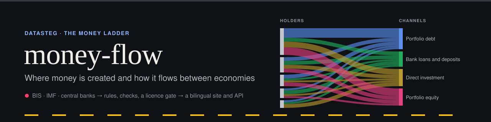
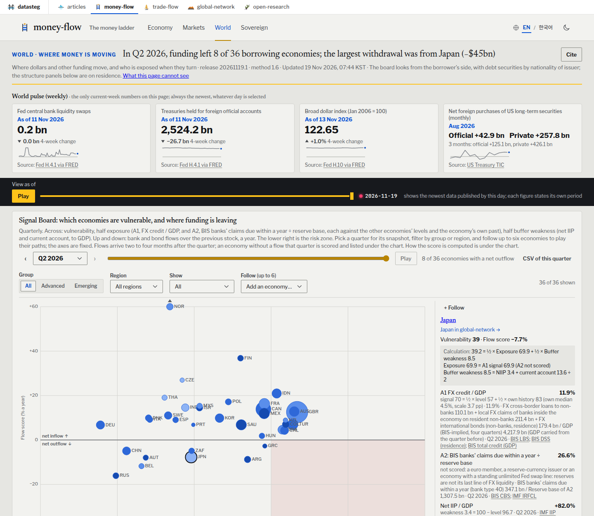
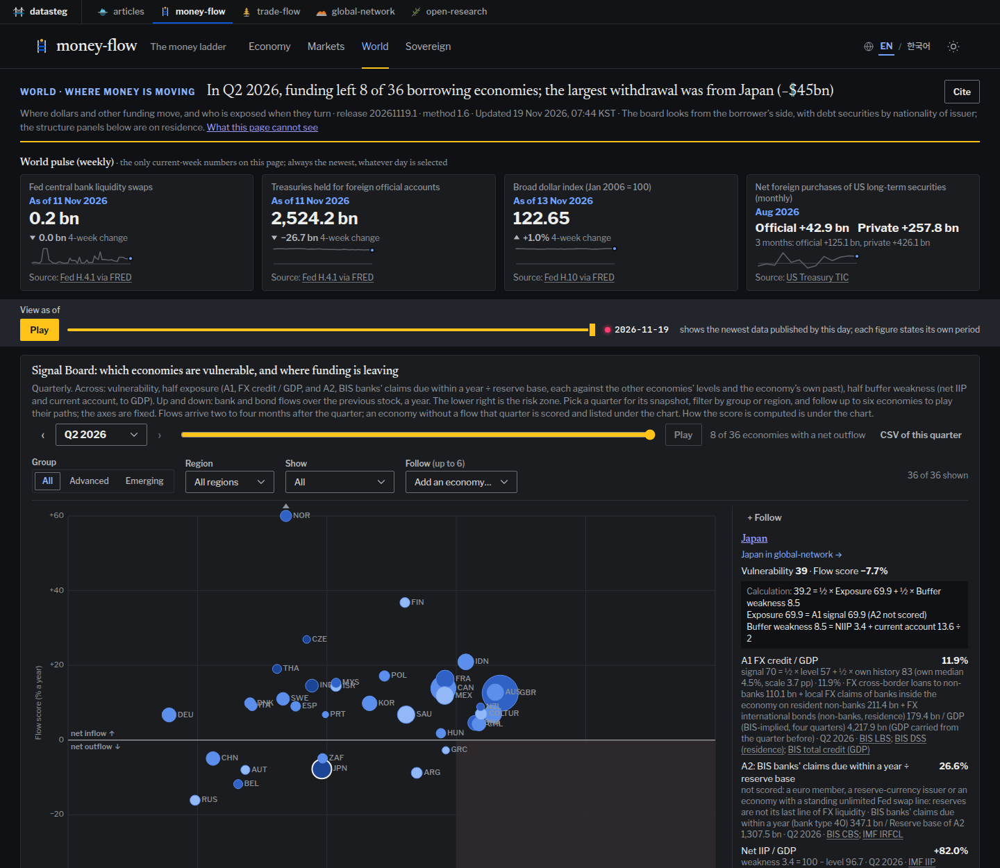
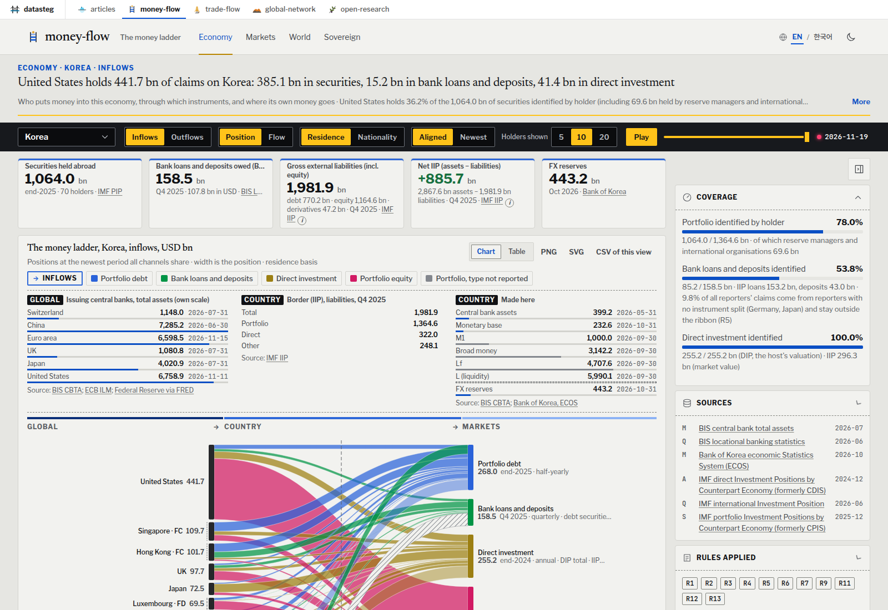
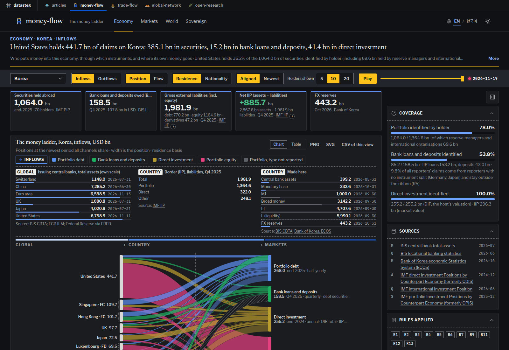
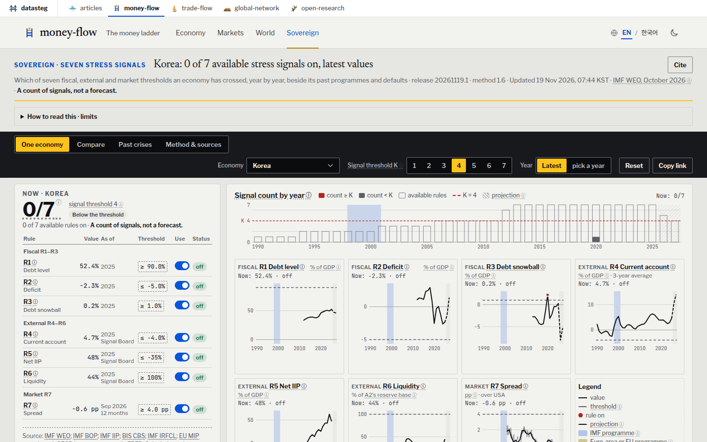

<p align="center"></p>

# money-flow

**money-flow** is the datasteg site that shows where money is created and how it moves between economies. It is
built from public statistics of the BIS, the IMF, the World Bank, the OECD and central banks, and it is published in
English and Korean at **https://money-flow.datasteg.com**.

This repository is the site's source: the pipeline that turns the publishers' files into checked tables and views,
the rules and checks that every published number passes, the Next.js site, and the Sinho design system it is drawn
in. It is a read-only snapshot for reading, not a kit for running the site (see [About this snapshot](#about-this-snapshot)).

| Day | Night |
|---|---|
|  |  |
|  |  |

## What the site shows

- **Economy: the money ladder.** For each of 179 economies, who holds claims on it (inflows) or what it holds abroad
  (outflows), by channel: portfolio debt, portfolio equity, bank loans and deposits, and direct investment. Beside the
  ribbons sit the global rung (the issuing central banks), the economy's border (its international investment
  position) and the money made at home (central bank assets, monetary base, broad money, reserves). Every view can be
  switched between position and flow, residence and nationality, and replayed day by day.
- **Markets.** One market (equity, bonds, bank loans and deposits, direct investment) across all economies as a
  holder × destination matrix, and *Cut a lender* (rule R21): the first-round loss if one banking system cut its
  loans to a borrower, set against that borrower's net reserves.
- **World.** The World pulse (Federal Reserve swap lines, Treasuries held for foreign official accounts, the broad
  dollar index, TIC net purchases) and the **Signal Board**: 36 borrowing economies placed by vulnerability (half
  exposure, half buffer weakness) against the bank and bond funding that reached them in the quarter. The score's
  design and its validation against 27 named external-stress episodes are in
  [docs/methodology/](docs/methodology/vulnerability-v1.4.md).
- **Sovereign.** Seven threshold rules on debt, deficits, the external accounts and bond spreads (R22–R28), counted
  for 36 economies each year since 1990, beside past IMF arrangements, euro-area and EU programmes and defaults. A
  count of signals, not a forecast.

  
- **Method, Checks, Sources, Releases.** The 28 rules and 27 checks with what each did in the current release, every
  source with its licence class and vintage, and every release kept and citable (`?r=<tag>` reopens any page as it
  was). Each view has a citation, a PNG/SVG figure export and, for open sources, a CSV of the drawn marks.

The same views are served to AI assistants and programs through the read-only
[datasteg API and MCP server](https://www.datasteg.com/en/technology/api) (tools `money_flow_board`,
`money_flow_economy`, `money_flow_bank_lenders`, `money_flow_sovereign`); [`api.yaml`](api.yaml) is money-flow's part
of that catalogue and [`app/app/svc/v1/`](app/app/svc/v1) holds the routes behind it.

## From public data to a published page

Each step below says what runs it. *Plain code* runs the same way every time and calls no model; almost all of it was
written by AI agents (Claude Code) and reviewed by a person. An *AI agent* step is one where a model does the work each
time it runs. The whole datasteg system is drawn at [datasteg.com/en/technology](https://www.datasteg.com/en/technology),
and every agent is listed at [datasteg.com/en/technology/agents](https://www.datasteg.com/en/technology/agents).

| # | Step | What happens | Who runs it | Where |
|---|---|---|---|---|
| 1 | Collect | A separate datasteg collector probes each publisher for change (Last-Modified and ETag for BIS files, `updatedAfter` on IMF SDMX, `last_updated` on FRED, a content hash for ECB and Bank of Korea ECOS) and stores a file only when its content changed. Nothing stored is overwritten; every vintage is kept. | Plain code | not in this repository |
| 2 | Publisher APIs | World Bank WDI, IMF SDMX (balance of payments, quarterly national accounts, WEO, investment positions) and OECD yields through FRED, one dated JSON file per run, with retries and back-off. | Plain code | [`scripts/fetch_wdi.py`](scripts/fetch_wdi.py), [`fetch_quarterly.py`](scripts/fetch_quarterly.py), [`fetch_warning.py`](scripts/fetch_warning.py) |
| 3 | Checked lists | Lists no API offers (IMF arrangements, ESM and EU programmes, sovereign defaults, the EU imbalance thresholds). An agent reads each publisher's page and writes the entry with its source; a person approves it; the build reads the file as data. | AI agent, approved by a person | [`config/sovereign_episodes.yaml`](config/sovereign_episodes.yaml), [`config/sources.yaml`](config/sources.yaml) |
| 4 | Tables | The newest vintage of every dataset key becomes five Parquet tables. Every row carries its dataset, vintage and raw file; `provenance` lists each raw file with its sha256. | Plain code | [`scripts/build_tables.py`](scripts/build_tables.py), [`config/datasets.yaml`](config/datasets.yaml), [`scripts/checks.py`](scripts/checks.py) |
| 5 | Rules and views | Rules R1–R28 turn table rows into marks: one unit (USD bn at BIS rates), totals only, one frequency per period, one report per country pair, quarantine of source errors, and the Signal Board and Sovereign arithmetic. | Plain code | [`scripts/sitebuild/`](scripts/sitebuild) (`marks.py`, `rules.py`, `views.py`, `sovereign.py`) |
| 6 | Gate and checks | The licence gate lets through only sources whose class may be shown and stops the build on any commercial vendor block. Checks V1–V27 run on the finished files; a failed blocking check means no release. | Plain code | [`gate.py`](scripts/sitebuild/gate.py), [`verify.py`](scripts/sitebuild/verify.py), [`config/method.yaml`](config/method.yaml) |
| 7 | Release | Files are stored by the sha256 of their content (brotli-compressed). A release is cut only when a file changed, and every release stays readable. Before the image is built, V11 runs again on everything it copies. | Plain code | [`release.py`](scripts/sitebuild/release.py), [`scripts/build_site_data.py`](scripts/build_site_data.py), [`scripts/check_release.py`](scripts/check_release.py) |
| 8 | Korean | Every Korean string is drafted by datasteg's Korean wording model (qkr) and recorded; the deploy fails on a Korean string that is not on record. No Korean is written by hand. | Model, checked at deploy | strings in [`app/lib/i18n.ts`](app/lib/i18n.ts) and the registries; particles by [`app/lib/josa.ts`](app/lib/josa.ts) |
| 9 | Site | A Next.js server reads the release store and renders each page on the server; the browser receives only what a page draws, with no series downloads. The container image carries the data, so each release is complete on its own. | Plain code | [`app/`](app), [`Dockerfile`](Dockerfile) |

The daily build and release run unattended and stop on any failed check. A person reviews every change to the rules,
the checks and the code; changing a rule raises the method version, which every release and citation records.

## The checks

- **One registry for rule text and code.** [`config/method.yaml`](config/method.yaml) holds each rule and check in
  English and Korean. Each rule names its function and its tests; the build stops when a rule has no function or no
  test, or a function names a rule that is not registered. The Method and Checks pages are written from this file.
- **Reproducible builds.** DuckDB runs on one thread so sums add in the same order every run; check V9 rebuilds two
  economies and compares the files byte for byte; V8 holds hand-checked regression figures for Korea.
- **Licence classes.** Every dataset in [`config/sources.yaml`](config/sources.yaml) has a class: `open` (shown, with
  attribution and a CSV of the drawn marks), `terms_pending`, `restricted`, `third_party` and `licensed` (never shown).
  Rule R14 keeps commercial data off the site: no public file may name a vendor or carry a fund-level field, the gate
  refuses vendor blocks, and [`tests/test_svc_v11.py`](tests/test_svc_v11.py) runs every API example against the
  same test.
- **Consistency with itself.** The standing rules C1–C5 shared by the datasteg flow sites: one quantity, one
  definition ([`app/lib/measures.json`](app/lib/measures.json)); one period rule for joins; like with like; every
  number carries its period and basis; and a check in the build for each rule.
- **Tests.** Python tests in [`tests/`](tests) (rules, sovereign rules, the export surface, the volume manifest, the
  API views) and Node tests in [`app/tests/`](app/tests) (citations, number formats, the lender cut, source links).

## Repository map

```
app/                    the Next.js site (App Router, server-rendered, English and Korean)
  app/[lang]/           pages: e/<ISO3> (Economy), m/<market> (Markets), world, sovereign, method, checks,
                        sources, releases, style (the design system drawn from the live CSS)
  app/svc/v1/           internal views for the datasteg API and MCP server
  components/           the ladder, the market matrix, the Signal Board, the Sovereign view, Sinho wrappers (sn/)
  lib/                  the release reader (data.ts), view models, citations, formats, strings, the measures registry
  tests/                node --test
config/                 the registries: sources and licences, datasets, method (rules and checks), economies,
                        redenominations, the Sovereign rules, episodes and glossary
design/                 Sinho: tokens.json, build-tokens.mjs (writes tokens.css and sinho.css), bundle.css, bundle.js
scripts/                fetchers, build_tables.py, checks.py, build_site_data.py, check_release.py, release_note.py
  sitebuild/            rules, views, the licence gate, checks V1–V27, the release store, citations, the volume manifest
  validation/           the validation behind the vulnerability score (methods 1.3 and 1.4)
tests/                  pytest
docs/methodology/       the decision memos for the Signal Board's vulnerability score
Dockerfile, api.yaml    the image (site and release store) and the API catalogue entry
```

## Design: Sinho

The site is drawn in **Sinho**, a design system that reads like a city's street signage: concrete pavement by day,
wet asphalt by night, the blue of a Korean road and station sign for every action, road centre-line yellow for marks
on dark ground, and one LED dot for "newest". Hard corners, solid fills and hairlines. The tokens live in
[`design/tokens.json`](design/tokens.json) and are generated into CSS for both themes; the live
[style page](https://money-flow.datasteg.com/en/style) draws every token from the site's CSS. The palette, the type and
where each token is used are in **[DESIGN.md](DESIGN.md)**.

## Links

- The site: https://money-flow.datasteg.com ([Method](https://money-flow.datasteg.com/en/method),
  [Checks](https://money-flow.datasteg.com/en/checks), [Sources](https://money-flow.datasteg.com/en/sources),
  [Releases](https://money-flow.datasteg.com/en/releases))
- datasteg: https://www.datasteg.com
- How datasteg works: https://www.datasteg.com/en/technology and its
  [AI agents](https://www.datasteg.com/en/technology/agents)
- API and MCP server: https://www.datasteg.com/en/technology/api

## About this snapshot

This is a read-only snapshot of the source, published to show how the site is made. It is not set up to run on its
own: the build reads the raw store of datasteg's private collector and the API views sit behind datasteg's own
services, neither of which is part of this repository. No data is included. datasteg publishes derived results only and
does not redistribute source data; to use the numbers, read them on the site or through the API, and cite the
publishers named on each page. Licensed commercial data are never shown on the site, and no code that reads them is
in this repository; only the guards that keep them out are.

© datasteg. All rights reserved.
